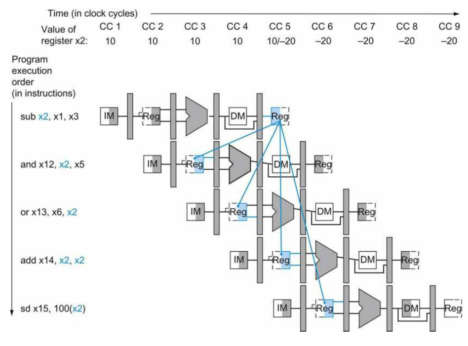
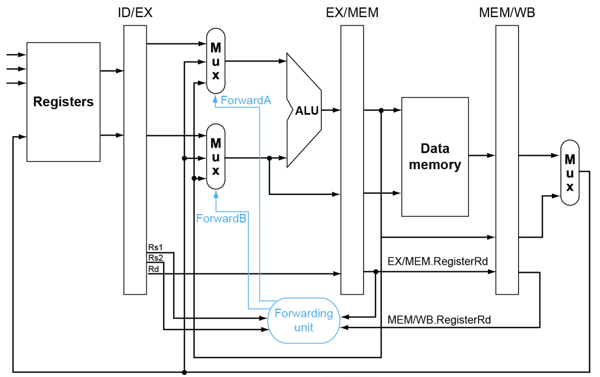
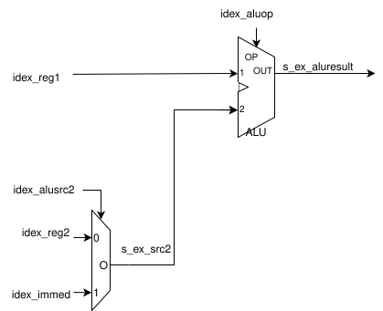
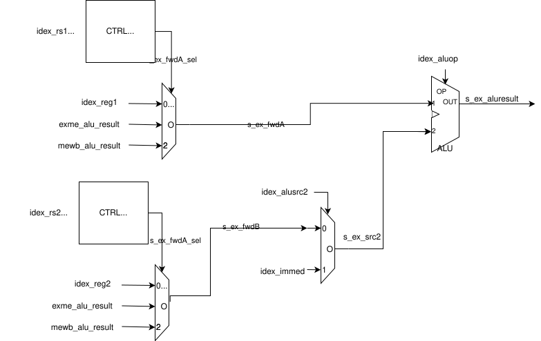
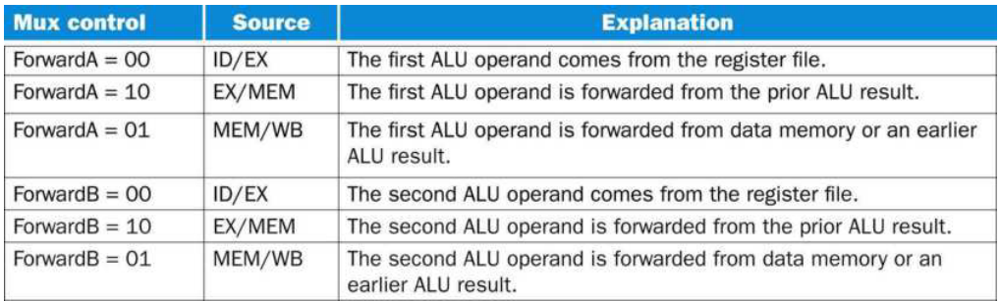

# Phase 5: Forwarding 

In this phase, you'll extend your Phase 4 code to support forwarding.  Note: we give you most of the details, but some you need to figure out.

With a pipelined processor, hazards may exist when there is one instruction that writes to a register and a subsequent one reads from it.  Shown below is Figure 4.50 from the text with an example, where you can see that from the first instruction x2 isn't written until clock cycle 5, but the second instruction needs to read it in clock cycle 3 (so, it would read the wrong value).  In Phase 4 we worked around this by inserting ```nop``` instructions -- see phase4-sample.S.  In Phase 5, we're solving it with Forwarding.




## Overview 

To start, copy all of your Phase 4 files to this directory and add to this Phase 4 repo.

You'll need to modify/create:
* cpu.sv
* decode.sv
* execute.sv
* enum_defines_pkg.sv
* system_tb.sv

The below Figure 4.52 from the textbook illustrates the logic we are going to add (not exactly, but we'll have more detailed diagrams below).  You can see that there are signals being fed back from the memory and writeback stages, where in the execute stage, the ALU might use the value read from the registers (reg1/reg2), or it might use one of the values fed back (which represent the values to be written to the register file in the future, which we've called alu_result for Phase 4).




## Changes to Make

The main change will occur in the Execute stage (execute.sv), but read the next few sections to understand overall what's going on, and then make the updates.

### execute.sv

The Execute stage needs to add logic to select one of three inputs to the ALU: (i) what was read from the register file for the instruction in the execute stage (inputs idex_reg1 and idex_reg2), (ii) what will be written to the register file for an instruction currently in the ME stage (so, the previous instruction) (which already exists as exme_alu_result), and (iii) what will be written to the register file for the instruction in the WB stage (mewb_alu_result).  This is illustrated in the following figures.

The first, shows the logic from Phase 4 (without forwarding).




The second shows the updated logic for Phase 5.  You can see the forwarding muxes on the left, along with control logic to select the correct input.



You can see that there's a new signals s_ex_fwdA_sel and s_ex_fwdB_sel which determine  (it will be of type alu_fwd_sel_t, see enum_defines_pkg.sv below).  The blocks labeled CTRL A and CTRL B are logic you need to implement (as one always_comb block each) -- see the text, lectures, or come to office hours to get help if you can't figure out what that should be.

Note: s_ex_fwdA is now the input to the first input of the ALU (was idex_reg1), and s_ex_fwdB is now the input to the mux that is selecting between a register value (s_ex_fwdB) or immediate, and outputs s_ex_src2.

New Inputs for Phase 5:
* idex_rs1, idex_rs2 // source registers for the instruction in the EX stage
* mewb_alu_result, mewb_rd, mewb_regwrite // what, where, and whether to write to the regfile for the instruction in the WB stage

Note: you do not need exme_alu_out/rd/regwrite as inputs, since it's already an output for the execute stage, and you can use those internal to the execute.sv file.  You will use them.

## decode.sv

Note that idex_rs1 and idex_rs2 are inputs to the execute stage.  So, you need to add them as outputs to the decode stage, and assign to them as part of the pipeline register (i.e., in the always_ff block setting all of the values that are outputs of the module).

## cpu.sv

You need to add the new outputs for decode to the decode instantiation (defining idex_rs1 and idex_rs2 as signals in cpu.sv).

You need to add the new inputs for execute to the execute instantiation (the signal definitions for the mewb_* signals are already defined, you just need to update the instantiation of execute and decode).

## enum_defines_pkg.sv

Add the following code to enum_defines_pkg.sv.

```
typedef enum logic  [1:0] {
    FWD_IDEX=2'b00,
    FWD_MEWB=2'b01,
    FWD_EXME=2'b10
} alu_fwd_sel_t;
```

This will be the type for s_ex_fwdA and s_ex_fwdB, and assigned to match Figure 4.53 in the textbook, shown below.



### system_tb.sv

You may need more clock cycles to run your test program.  Currently, it is set to run for 50 clock cycles.  Set it to a higher number if your test program needs more cycles.

```
  repeat (50) @(posedge clk);
```


## Testing

In this Phase, we are providing test assembly code (phase5-provided.S) that you can use to check for correctness that tests various cases. 


You can look in the output log to see what values are being written to the register file.  Check those are what you expect based on the program -- e.g., you can run this code in cpulator and see what registers are updated to what values and in what order.  We also include comments for what you should expect.  Then compare against what you see running this assembly program in your Phase5 SystemVerilog code.  You can use this to help:

```
./system_tb.out > out.log
grep "Register" out.log
```

To debug, use gtkwave and particularly focus on the signals from the diagram shown above (when discussing execute.sv).


## AI Use

You need to create a new file AI-use-statement.md and include a statement on how exactly you used AI (tools, prompt examples).

Note -- acceptable uses:
* Learning SystemVerilog -- e.g., provide an example of slicing in SystemVerilog.
* Code completion e.g., if I start typing something and it recognisizes a pattern, it will suggest some code to use that matches that pattern.

Note -- unacceptable uses:
* Asking it to create whole verilog code
* Proving the instructions (or code) from the assignment as asking it to complete all or part.

If in doubt, ask.  


## Submission / Grading

Add any new files you created to the git repo, and commit/push all changes.  Do not include temporary files.  We include a .gitignore that should catch these.  Temporary files include .o, .out, .bin, etc.  Do not include those.

Submit the URL in canvas as the submission when you are completed. 


### Rubric:
20 points total

If your System Verilog code does not compile and run without errors, you will be assigned a 0.  You will be given 1 opportunity, and 24 hours, to correct and notify the TA that let you know.

with a solution that does compile/run, below is the rubric:

1 point for file AI-use-statement.md (if you called it AI_use_statement.md, that's fine too).

7 points for code that looks right (they exist and look reasonable to the TA.  This is effectively the opportunities for partial credit when your code doesn't work):
* (0.5) decode -- new outputs and assignment
* (1) execute -- new inputs
* (2) execute -- fwdA, fwdB muxes
* (2) execute -- fwdA_sel, fwdB_sel logic (CTRL A and CTRL B in the diagram)
* (1)execute -- updated ALU and src2 mux inputs
* (0.5) cpu.sv -- wired up new inputs/outputs

12 points for correct execution (we'll use phase5-provided.S, which, has 12 registers that get modified), where you'll get credit based on how many are correct.


